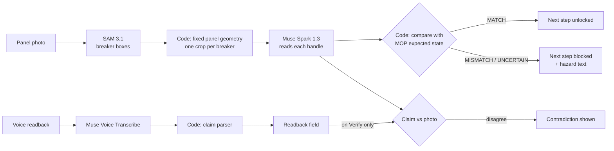

# DC-EPMS PRO - a3semi Edge Operations Platform

## Meta Global AI Developer Hackathon: MOP Verification

**Live demo:** https://dc-epms-pro.onrender.com/ (demo mode: only the MOP Verification view is shown)

**Demo video:** https://youtu.be/QxA8sZA_7t8

**A second pair of eyes for every breaker operation.** At each step of a Method of Procedure (MOP), the technician photographs the breaker panel. Meta models read every breaker handle, code compares each reading with the procedure, and the next step stays locked until the panel matches, with the hazard written for that step. The technician can also read the step back by voice; Verify flags it when that claim and the photo disagree.

### Built during the hackathon vs. pre-existing

| | |
|---|---|
| **Built October 26 to November 4, 2026** | MOP photo verification (vision pipeline, procedure state machine, verdict and hazard logic), voice readback transcription and claim parser, demo mode with intro card, request limits and trace log, Render deployment, and an agentic investigator endpoint (API only, checklist first) |
| **Pre-existing base, built before October 26** | The DC-EPMS PRO data center digital twin and dashboard described in the rest of this README. Demo mode hides it; it is not part of the hackathon submission |

### How it works



The models only read; every decision is made in code. Voice never triggers a verification by itself: it fills the readback field, and the comparison happens when the user presses Verify.

| Meta model | Used for |
|---|---|
| SAM 3.1 | Locating the breakers in the photo |
| Muse Spark 1.3 | Reading each breaker handle from its crop |
| Muse Voice Transcribe | Turning the spoken readback into text |

### Evidence

Each row is a separate kind of evidence; the counts are not merged.

| Type | Result |
|---|---|
| Vision probe on real panel photos | 10/10 verdicts and 45/45 breaker labels correct. Method caveat: only one frame met the literal 8-box rule; the others were resolved with the column split method |
| Live UI | Step 0 MISMATCH with photo 07; step 0 MATCH with photo 01; step 2 MISMATCH after steps 0 and 1 |
| Direct checks | Photo 08 returns a real UNCERTAIN. A restoration photo returns MISMATCH only on BYP against step 2; it is a separate residential state, never a MOP step |
| Voice | Claim parsing and claim checks: 22 automated tests. Replay of sample readbacks s0 to s5: 6/6. Combined run: 11/13, where the 2 rejections ("BYP plus", "QA closet") are correct rejections |
| Manual robustness batches | Rate limit (429 with no Meta call), server down, and session lost after a restart (409 with no Meta call), audited from the server trace log |
| Deployment on Render | Demo mode load, Verify, transcription, and per-visitor rate limit checked from two networks |
| Agentic investigator, live run | Both scenarios returned the expected cause, P1 and procedure (burst-utility-01: utility_loss via MOP-ATS-MONTHLY-001; burst-cooling-02: cooling_loss via EOP-COOLING-LOSS-001) within 6 model calls (limit 8), using 4 tools. The counter-evidence checklist item stayed unsettled, so the code capped confidence at medium |
| Automated test suites | Backend 1565 passed, frontend 622 passed. These are the full suites and include tests of the pre-existing platform |

### Privacy

In this demo, procedure sessions live in server memory and reset when the server restarts. Photos and voice clips are sent to the Meta API for analysis and are not saved by this app.

### Limits

- Per-IP limiting relies on the X-Forwarded-For header set by the hosting proxy; the global daily cap is the hard budget guard.
- Public demo limits: 10 Meta-backed requests per visitor per rolling hour, 50 per day for the whole demo, checked before any Meta call.
- Procedure sessions live in server memory and reset when the server restarts; the app then asks the user to restart the procedure.
- Residential training panel, not a live UPS. The breakers represent a maintenance bypass cabinet and control nothing. This is a demonstration, not a safety device.
- The panel geometry is calibrated to this one training panel.
- The sample readbacks in `frontend/assets/demo_audio/` are synthetic voice clips generated with ElevenLabs (text-to-speech), not a live operator. They are pre-recorded files; the app does not call any TTS service. At runtime it only calls Meta models.
- The demo video narration is synthetic voice generated with ElevenLabs (text-to-speech).

---


> **Founder-built MVP.** A-Cubed Semiconductor Systems Inc. (a3semi) is my company, registered in Canada (pre-revenue). This repository is the MVP: a data center digital twin with AI-assisted operations. The facility (A3-Alpha Toronto Area), the deployment described, and all telemetry, incidents and procedures are simulated for demo purposes.

**A-Cubed Semiconductor Systems Inc. (a3semi)** — EPMS platform for critical infrastructure monitoring and simulation.

Simulated facility: **A3-Alpha** (Tier IV 2N, 40 MW, 118 x NVIDIA GB200 NVL72 racks — all simulated).

**Version 1.0** — includes dual utility 2N simulation, What-If analysis, AI agent with RAG grounding, and MCP server for Claude Desktop integration. See `docs/DEMO_SCRIPT.md` for the demo flow.

---

## Quick start — 3 tiers

### Tier 1 — Minimal (UI preview, ~60 MB, 2 min)
Just enough to see the dashboard and test the SPA.
```powershell
cd DC-EPMS_PRO
.\scripts\start.ps1 -Install -Minimal
.\scripts\start.ps1
```
Browse → `http://localhost:8080`. Status pills all show down (expected). Layout, KPIs (empty), PDF button work.

### Tier 2 — Full stack (~800 MB, 8 min)
PostgreSQL + TimescaleDB + ChromaDB RAG + all features.
```powershell
# Requires Docker Desktop running
cd DC-EPMS_PRO
.\scripts\start.ps1 -Install
.\scripts\start.ps1
```
Opens dashboard with real PostgreSQL and RAG. Status pills green.

### Tier 3 — Full + simulator (demo mode)
Continuously generates telemetry and incidents for demo.
```powershell
.\scripts\start.ps1 -Simulator -Scenario chillerFail
```
Dashboard fills with live data. Advisory banners appear when PUE > 1.40.

---

## Architecture

```
                Frontend SPA (index.html)
                  - SSE: token-by-token agent response
                  - SSE: telemetry every 5s
                  - Chart.js PUE trend (60 samples)
                  - Voice stub (Riva-ready)
                  - Shift report PDF download
                         |
                         | HTTP/SSE :8080
                         v
                FastAPI (backend/main.py)
                  - /agent/stream   NeMo -> Gemma/Claude
                  - /api/telemetry  PostgreSQL
                  - /api/rag/query  ChromaDB
                  - /api/shift/report  reportlab PDF
                  - /lm/*           LM Studio proxy
                         |
         +---------------+---------------+
         v               v               v
      Postgres       ChromaDB        LM Studio
      + Timescale    + MiniLM        Gemma 4 + GPU
      :5432          (local)         :1234
```

---

## Project layout

```
DC-EPMS_PRO/
  backend/
    main.py              FastAPI orchestrator (556 lines)
    agent_engine.py      NeMo Guardrails + Gemma/Claude stream
    database.py          asyncpg + TimescaleDB hypertable
    rag_service.py       ChromaDB thread-safe
    shift_report.py      reportlab PDF generator
  frontend/
    index.html           Clean SPA (158 lines)
    assets/
      app.css            Industrial styling (562 lines)
      app.js             SSE + Chart.js + voice (555 lines)
  config/
    config.yml           NeMo Guardrails rails
    actions.co           Colang dialog flows
    .env.example         Credentials template
  scripts/
    start.ps1            One-click Windows launcher
    seed_rag.py          Index 14 Schneider + ASHRAE + IEC docs
    simulator.py         Physics-based telemetry generator
    migrate_from_legacy.py
  tests/
    test_smoke.py        8 pytest validations (all pass)
  docker-compose.yml     PostgreSQL + backend
  Dockerfile             Production container
  requirements-minimal.txt    UI only (60 MB)
  requirements-full.txt       Full stack (800 MB)
  requirements.txt            Alias -> requirements-full
```

---

## API Reference

### Agent streaming
`POST /agent/stream` — SSE token stream with NeMo rails + RAG grounding
```json
{ "query": "...", "model_hint": "auto|gemma|claude", "max_tokens": 500 }
```

### Telemetry
- `POST /api/telemetry` — Write point (fires PUE advisory if > 1.40)
- `GET /api/telemetry?limit=60` — Recent points
- `GET /api/telemetry/stream` — SSE push every 5s

### Incidents (SQL-injection safe, JSONB validated)
- `POST /api/incidents` — Create with physics_json
- `GET /api/incidents?limit=50` — Recent

### RAG
- `POST /api/rag/query` — Semantic search (cosine similarity)
- `GET /api/rag/docs` — Indexed count

### LM Studio proxy (CORS bypass, uses 127.0.0.1 not localhost)
- `GET /lm/v1/models`
- `POST /lm/v1/chat/completions`

### Reports
`POST /api/shift/report` — Generate PDF with telemetry + incidents + open items

### Ops
`GET /api/health` — Unified: Postgres + ChromaDB + Gemma + GPU

### Voice (Riva-ready stub)
`POST /api/voice/transcribe` — WSL2 integration point

---

## Standards

- CSA Z462 / NFPA 70E — Arc flash Cat 2, LOTO
- NFPA 110 Type 10 — Emergency power (10-second transfer)
- ASHRAE A2 — Thermal envelope 10-35C
- IEC 62443 — OT cybersecurity SL-0 through SL-3
- ISO 22301 — P1 RTO=15min RPO=0
- Schneider WP122 — Critical power and cooling

## Hardware model (simulated facility)

- 118 x NVIDIA GB200 NVL72 Blackwell racks @ 142 kW DLC = 16,756 kW nominal
- Tier IV 2N 40 MW total facility capacity
- DLC inlet 18C, outlet max 45C, flow 40 L/min glycol

## Author

Wilmer Angel — Founder, A-Cubed Semiconductor Systems Inc. (registered in Canada)

---

## Claude Desktop / MCP integration

DC-EPMS PRO ships with a Model Context Protocol (MCP) server that exposes
the live facility state to Claude Desktop and other MCP clients.

### Setup

1. Copy the example config:
   ```powershell
   copy config\claude_desktop_config.example.json `
        $env:APPDATA\Claude\claude_desktop_config.json
   ```

2. Edit the new file and replace `{PROJECT_PATH}` with your absolute path
   (e.g., `C:/dev/DC-EPMS_PRO`). Use forward slashes.

3. Restart Claude Desktop.

### What's exposed

**4 resources** (read-only data):
- `a3semi://telemetry/current` — latest telemetry snapshot
- `a3semi://physics/site-health` — Site Health Index + per-module health
- `a3semi://scenarios/list` — 10 failure scenarios catalog
- `a3semi://incidents/recent` — last 20 incidents from PostgreSQL

**3 tools** (callable functions):
- `simulate_failure(scenario_id, horizon_s)` — physics-engine simulation
- `read_bms_tag(tag_id)` — read any BACnet/Modbus tag
- `list_bms_tags(category?)` — browse 42 tags by category

### Test the MCP server standalone

```powershell
cd DC-EPMS_PRO
python backend\mcp_server.py
# Type a JSON-RPC request:
#   {"jsonrpc":"2.0","id":1,"method":"resources/list","params":{}}
# Then press Enter; the server replies with the result.
# Ctrl+C to exit.
```

## Meta Global AI Developer Hackathon submission (Oct 26 - Nov 4, 2026)

Track: Indie Developer, theme: Build for Your World.
Project: Facility Shift Copilot, Shift Forensic Investigator.

### Pre-existing base (built before the hackathon, NOT claimed as hackathon work)
- The EPMS/BMS digital twin, in use since February 2026.
- The deterministic Shift Copilot: alarm correlation (15-minute window),
  P1/P2/P3 triage, MOP-style log draft, shift handover, and the demo
  scenarios (utility_failure, chiller_fail, random_burst).
  Files: `backend/shift_copilot.py`, `backend/llm_providers.py` (Meta
  provider seam only, not wired to investigation before the hackathon),
  the Incidents-view panel.

### Built during the hackathon (the submitted feature)
- Shift Forensic Investigator agent: `backend/copilot_forensic.py`.
  It collects every alarm in a burst as evidence, rebuilds the
  timeline in chronological order, tests hypotheses against that
  evidence (and rules out what the evidence contradicts), names a
  probable cause with a confidence level, states what is still
  unconfirmed, and gives a verification checklist for the operator
  to confirm in person. It never changes the deterministic priority,
  score, or suggested procedure. If no Meta key is configured or the
  API call fails, it returns the deterministic investigation and
  labels that source. A Meta model, when configured, performs the
  same investigation from the same evidence list, with the same
  guardrails.
- Endpoint: `POST /api/copilot/investigate` (mounted in `backend/main.py`).
- Demo script: `scripts/demo_forensic.py` (utility_failure scenario,
  no API key required for the fallback path).
- The 3-minute demo video shows only this investigation feature; the
  twin and the deterministic triage appear only as brief context.

### Run the forensic demo (fallback, no key needed)
```powershell
python scripts/demo_forensic.py
```
With a Meta key, set `META_API_KEY` (and optionally `META_MODEL`) as
environment variables, never in code. The key is not included in this repo.
